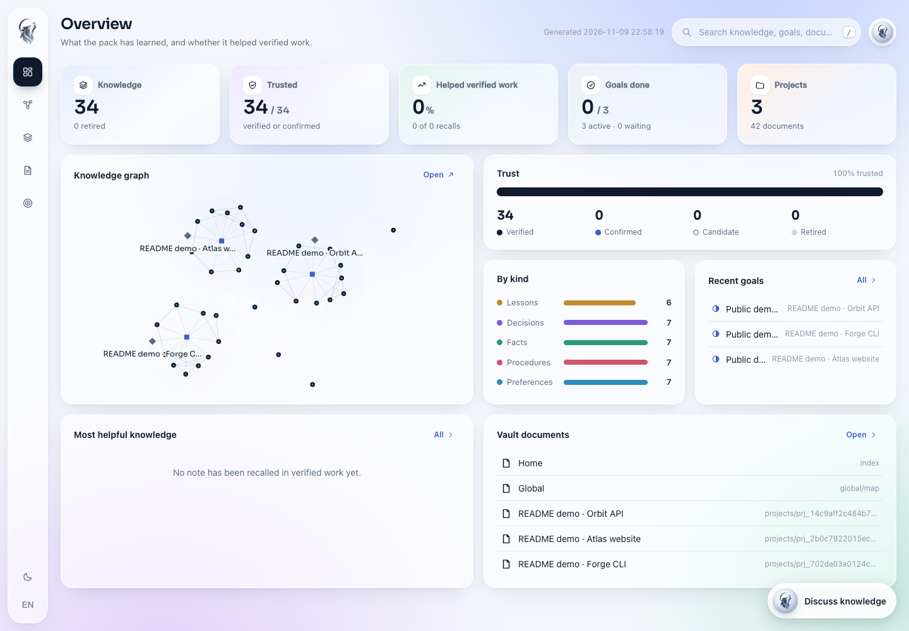
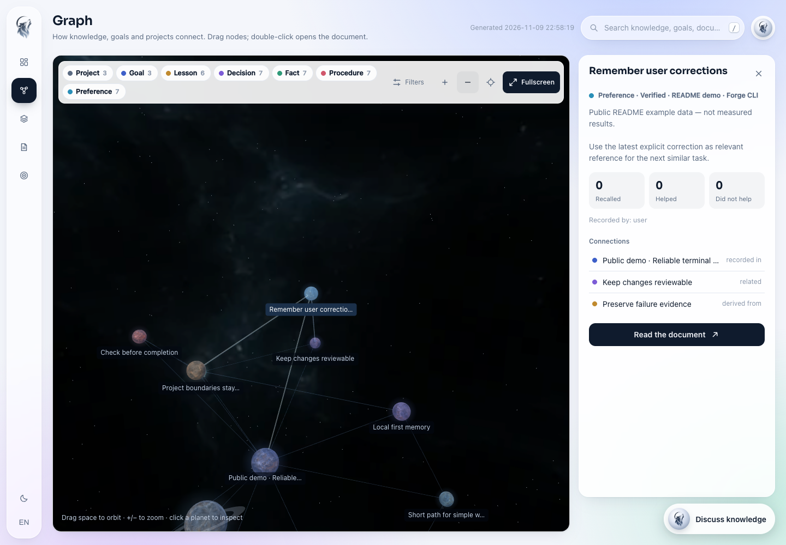

<p align="center">
  
</p>

# LUPUS

**필요한 기억만 꺼내고 작업에 맞게 실행하고 검사로 완료를 확인합니다.**

LUPUS는 macOS에서 쓰는 터미널 중심 AI 코딩 도구입니다. 제공자·모델·작업 모드를 직접 고르고 다음 작업에 필요한 지식을 이어 쓰며 검사 조건과 예산을 정해 작업을 진행합니다.

[English](README.md) · [빠른 시작](#빠른-시작) · [최신 화면](#최신-화면) · [CLI 가이드](lupus/README.md)


[](LICENSE)


## LUPUS가 하는 일

저장소에 대한 간단한 질문은 짧게 처리합니다. 코드를 고칠 때는 범위를 정하고 검사 조건이 있는 작업은 통과 기록을 남깁니다. LUPUS는 이 흐름을 하나의 CLI에서 제공하며 기억과 작업 상태를 로컬에 보관합니다.

- **필요한 기억 회상:** 현재 요청과 관련된 프로젝트 사실·결정·교훈을 입력 예산 안에서 골라 전달합니다.
- **수정 이력 활용:** 사용자가 명시한 피드백과 출처를 남깁니다. 작성자를 알 수 없는 파일 변경은 후보로 기록합니다.
- **실행 방식 선택:** 제공자와 모델을 고르고 독립된 목표를 병렬로 실행하며 필요할 때 실패 후 감독 역할을 켤 수 있습니다.
- **검사에 따른 완료 판단:** 검사 결과, 예산, 변경 내역과 소유한 작업 프로세스를 추적합니다.

위 기능은 현재 코드에 구현되어 있습니다. 토큰 절약, 속도 향상, 같은 실수의 감소, 다른 도구 대비 전반적인 우위는 별도로 검증해야 할 목표입니다.

## 빠른 시작

**macOS**, **Python 3.12 이상**, Python에 연결된 **SQLite 3.51.3 이상과 FTS5**가 필요합니다. AI 작업에는 설치·로그인된 네이티브 CLI, 설정한 API 제공자 또는 실행 중인 로컬 모델 서버를 연결해야 합니다.

```bash
git clone https://github.com/djfksjd/lupus.git
cd lupus
python3 -m venv .venv
source .venv/bin/activate
python -m pip install -e ./lupus
lupus
```

처음 선택되는 제공자는 **Codex**입니다. 저장한 설정이나 `LUPUS_DRIVER`가 있으면 그 값을 따릅니다. 제공자를 선택해도 프로그램 설치나 모델 다운로드는 실행하지 않습니다.

LUPUS 안에서 다음과 같이 시작할 수 있습니다.

```text
/provider codex
/model default
/mode ask
이 저장소의 구조를 설명해줘.
```

`/`를 입력하면 제안 목록이 열립니다. 방향키로 고르고 **Tab**으로 입력하고 **Enter**로 확정합니다. `/mode`처럼 선택지가 있는 명령은 다음 선택 단계로 이어집니다. **Esc**는 입력을 보존한 채 제안 목록을 닫습니다.

## 작업에 맞는 모드

| 모드 | 동작 |
|---|---|
| `auto` | 요청을 살펴 간단한 로컬 처리·답변·수정·검증 작업으로 보냅니다. |
| `ask` | 작업 공간을 읽기만 하며 답변합니다. |
| `agent` | 파일을 수정할 수 있으며 결과는 미검증 상태로 남습니다. |
| `verify` | 명시한 검사 조건에 따라 작업하고 검증 기록을 남기는 흐름을 사용합니다. |

`/mode ask`, `/mode agent`, `/mode verify`로 세션 모드를 바꿉니다. 한 번만 적용하려면 `/ask TASK`, `/agent TASK`, `/verify TASK`를 씁니다.

셸에서 검사 명령을 직접 지정할 수도 있습니다.

```bash
lupus auto "페이지 계산 오류를 수정해줘"   --check "python3 -m unittest test_inventory" --driver codex
```

요청과 검사 명령은 프로젝트에 맞게 바꾸세요. 검사 통과는 기록한 조건을 충족했다는 뜻이며 코드 전체의 정확성을 보장하지는 않습니다.

## 제공자·모델·스킬

`/provider`에서 제공자 목록을 확인하고 `/model`로 모델을 고릅니다. `/model default`는 기본 모델로 되돌립니다. `/models`는 설정된 목록을 보여주며 `/models --discover`는 지원되는 제공자에 모델 조회를 명시적으로 요청합니다.

| 연결 방식 | 제공자 ID |
|---|---|
| 설치한 네이티브 CLI | `codex`, `claude` |
| 외부 API | `glm`, `openrouter`, `deepseek`, `gemini` |
| 로컬 서버 | `ollama`, `lmstudio` |
| 사용자 지정 엔드포인트 | `openai-compatible` |

목록에 있는 제공자는 연결 경로가 구현되어 있습니다. 모든 모델과 백엔드의 실제 호환성을 확인한 것은 아닙니다. API 설정에는 키 값 대신 환경변수 이름을 기록합니다. 설정 예시는 [CLI 가이드](lupus/README.md#provider-configuration)에 있습니다.

`/skills`는 발견한 로컬 스킬과 OMC·Superpowers에서 가져와 조정한 기본 지침을 보여줍니다. `/skill ID TASK`로 사용할 스킬을 지정할 수 있습니다. 스킬 접근 범위는 백엔드와 네이티브 프로필에 따라 다릅니다.

## 기억과 병렬 작업

**기억은 필요한 만큼 꺼냅니다.** 구조화한 지식 중 요청과 관련된 메모를 입력 예산 안에서 검색합니다. DB·생성된 Vault·작업 로그에 보관하는 정보와 모델에 전달하는 정보는 다릅니다. 저장된 모든 내용을 압축한다거나 로그를 전혀 보관하지 않는다는 뜻은 아닙니다.

**정정에는 이력을 남깁니다.** 명시한 피드백, 대체된 메모와 관측한 파일 변경을 다음 작업의 참고 자료로 쓸 수 있습니다. 설명 없이 바뀐 파일만으로 수정한 사람을 단정하지 않습니다. 후보와 회상한 메모는 검토가 필요하며 같은 실수를 줄이는 효과는 아직 입증되지 않았습니다.

**병렬 실행에는 독립된 범위가 필요합니다.** `/parallel auto`나 `/parallel 2`는 이미 등록된 열린 목표를 동시 실행 수에 맞춰 처리합니다. 동시에 코드를 쓰려면 서로 다른 프로젝트나 격리된 체크아웃을 사용해야 합니다. 한 요청을 자동으로 여러 에이전트의 작업으로 나누는 기능은 아닙니다.

**감독 역할은 선택 사항입니다.** `/supervisor PROVIDER MODEL`로 해당하는 검증 실패 때 개입할 별도 모델을 지정하고 `/supervisor off`로 끕니다. 실행 모델과 감독 모델은 사용자가 고릅니다. 평소 요청 분류는 추가 감독 호출 없이 로컬 규칙으로 처리합니다.

## 최신 화면

**2026-11-09**에 **공개 예시 데이터**로 캡처한 실제 LUPUS 화면입니다. 이미지의 개수·신뢰 상태·목표는 데모 값이며 개발 실적이나 성능 측정 결과가 아닙니다.

### 대시보드

저장된 지식, 목표 상태와 프로젝트를 한눈에 확인합니다.

[](asset/screenshots/dashboard-20261109.png)

### 노드 그래프

3D 그래프에서 지식의 연결을 살피고 선택한 노드의 출처와 관계를 확인합니다.

[](asset/screenshots/node-graph-20261109.png)

```bash
lupus graph --open                 # 뷰어를 생성하고 브라우저에서 열기
lupus graph --serve --open         # 지식 대화를 포함한 로컬 뷰어 서버
```

지식 대화는 뷰어에서 고른 Codex나 Claude Code를 호출할 수 있습니다. 이번 캡처에서는 모델을 호출하지 않았습니다. 상단의 달·돌 이미지는 생성한 콘셉트 아트이고 위 두 화면은 실제 UI 캡처입니다.

## 현재 상태와 한계

LUPUS는 **alpha** 단계입니다. 터미널 선택 흐름, 제공자 설정, 선택적 기억, 수정 이력, 목표 병렬 실행과 프로세스 수명 관리가 코드에 들어 있습니다. 실제 환경별 백엔드 호환성, 터미널 동작과 종료 후 정리는 추가 검증이 필요합니다.

- **보안:** 실행 정책과 보호된 검사는 특정 위험을 줄이기 위한 장치입니다. VM 격리나 정보 유출 방지 전반을 보장하지 않습니다. 네이티브 프로필·hook·MCP 도구와 API 작업 공간 도구는 권한 경계가 다릅니다.
- **작업 종료:** 대기 중인 입력창에서 Ctrl+C를 누르면 종료합니다. 작업 중에는 취소를 요청한 뒤 입력창으로 돌아옵니다. `/jobs`에서 추적 중인 백그라운드 작업을 확인할 수 있습니다. 소유한 프로세스와 컨테이너를 정리하도록 구현했으며 모든 고스트 세션이 없음을 입증한 상태는 아닙니다.
- **경쟁 비교:** 기본 CLI, OMO, Aider 등보다 비용·속도·정확성·보안이 전반적으로 우수하다는 주장은 아직 입증되지 않았습니다. 과거의 좁은 범위 측정만으로 그 결론을 내리지 않습니다.

## 더 알아보기

- [CLI 가이드와 제공자 설정](lupus/README.md)
- [검증 계약](lupus/docs/CONTRACT.md)
- [외부 프로젝트와 라이선스](lupus/THIRD_PARTY_NOTICES.md)
- [라이선스](LICENSE) — Apache 2.0
