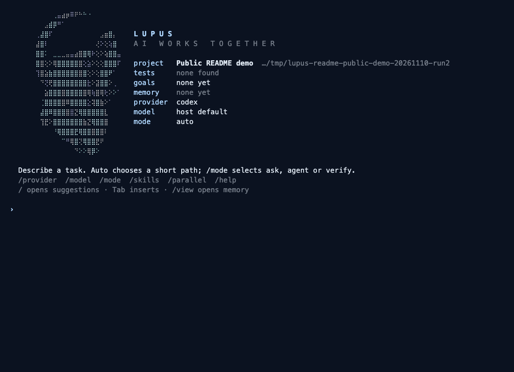
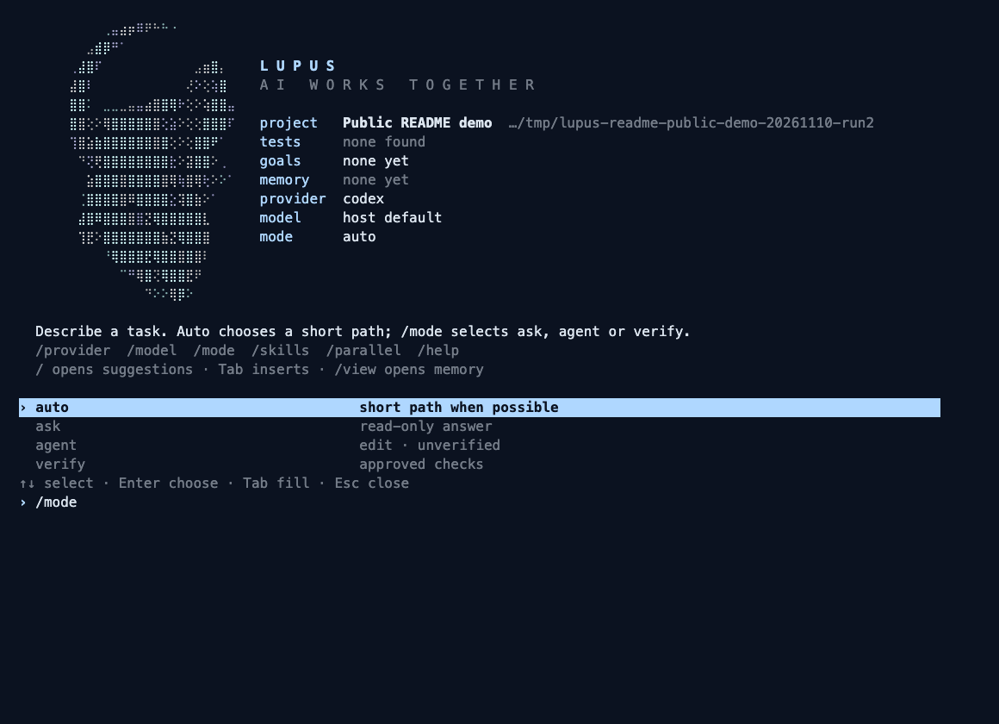
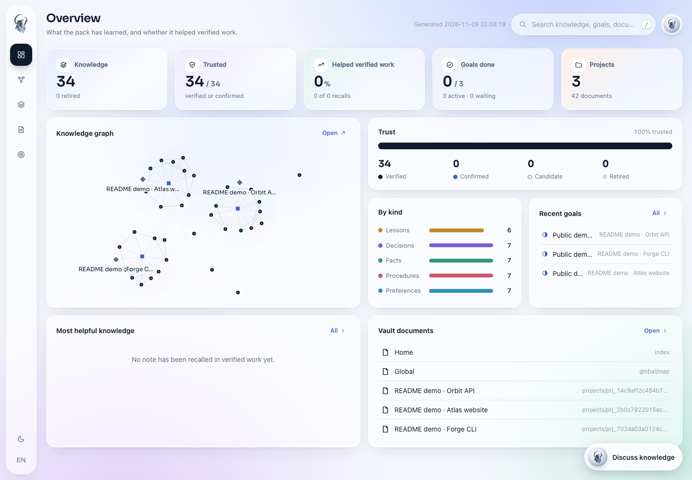
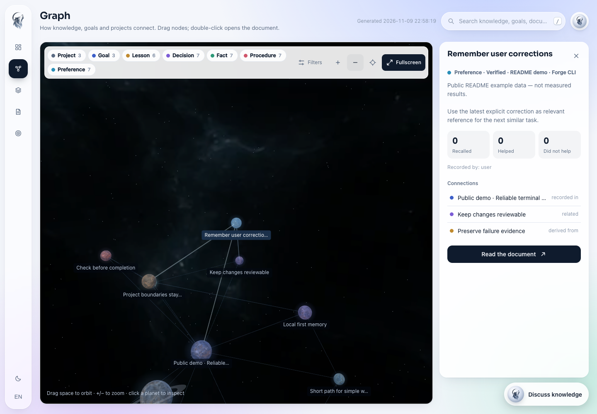

<p align="center">
  
</p>

# LUPUS

**Relevant memory. The right amount of work. Checks before completion.**

LUPUS is a local, terminal-first workspace for AI coding on macOS. Choose your provider, model and working mode, carry useful knowledge between tasks, and run bounded work with explicit checks and budgets.

[한국어](README.ko.md) · [Quick start](#quick-start) · [Terminal CLI](#terminal-cli) · [Current UI](#current-ui) · [CLI guide](lupus/README.md)


[](LICENSE)


## Why LUPUS

A repository question should take a short path. A code change needs a clear scope. A task with acceptance checks needs evidence before it is marked complete. LUPUS provides these paths in one CLI, with memory and task state kept locally.

- **Use relevant memory.** Retrieve a small, budgeted selection of project facts, decisions and lessons for the current request.
- **Learn from corrections.** Keep explicit feedback and provenance; record observed edits as candidates when their authorship is unknown.
- **Choose how work runs.** Select a provider and model, use independent goals in parallel, and enable an on-failure supervisor when needed.
- **Keep completion reviewable.** Track checks, budgets, changes and owned jobs instead of relying on a model's completion message.

These are implemented mechanisms. Lower token use, faster work, fewer repeat mistakes and broad superiority over other tools remain validation goals.

## Quick start

Requirements: **macOS**, **Python 3.12+**, and Python's **SQLite 3.51.3+ with FTS5**. For AI work, connect an installed and authenticated native CLI, a configured API provider, or a running local model server.

```bash
git clone https://github.com/djfksjd/lupus.git
cd lupus
python3 -m venv .venv
source .venv/bin/activate
python -m pip install -e ./lupus
lupus
```

The initial provider is **Codex**, unless a saved preference or `LUPUS_DRIVER` selects another. LUPUS does not install providers or download models when you select them.

Inside LUPUS:

```text
/provider codex
/model default
/mode ask
Explain the structure of this repository.
```

Type `/` for suggestions. Use the arrow keys to select, **Tab** to insert, and **Enter** to confirm. Commands with choices, such as `/mode`, open the next selection step. **Esc** dismisses suggestions and preserves your input.

## Pick the amount of work

| Mode | What happens |
|---|---|
| `auto` | Routes the request to a short local path, an answer, an edit or a verified workflow. |
| `ask` | Answers with read-only workspace access. |
| `agent` | Allows edits; the result remains unverified. |
| `verify` | Uses the workflow for explicit acceptance checks and recorded verification. |

Use `/mode ask`, `/mode agent` or `/mode verify` to change the session. `/ask TASK`, `/agent TASK` and `/verify TASK` apply a mode to one request.

For an explicit check from your shell:

```bash
lupus auto "Fix the pagination offset"   --check "python3 -m unittest test_inventory" --driver codex
```

Replace the request and check with ones for your project. Passing checks establishes the recorded conditions; it does not establish general correctness.

## Providers, models and skills

`/provider` lists the catalog. `/model` selects a model for the chosen provider; `/model default` returns to its default. `/models` shows configured choices, and `/models --discover` explicitly requests discovery where supported.

| Connection | Catalog IDs |
|---|---|
| Installed native CLI | `codex`, `claude` |
| Hosted API | `glm`, `openrouter`, `deepseek`, `gemini` |
| Local server | `ollama`, `lmstudio` |
| Custom endpoint | `openai-compatible` |

Catalog presence describes a connection path, not confirmed compatibility with every model or backend. API profiles store environment-variable names for credentials. See the [CLI guide](lupus/README.md#provider-configuration) for configuration.

`/skills` lists discovered local skills and bundled guidance adapted from OMC and Superpowers. Use `/skill ID TASK` to request a skill explicitly. Skill access depends on the selected backend and native profile.

## Memory and coordinated work

**Memory is selective.** LUPUS stores structured knowledge and retrieves relevant notes within a prompt budget. The database, generated vault and job logs are separate from the small selection sent to a model. This is not a promise that all stored data is compressed, or that local storage contains no logs.

**Corrections have a history.** Explicit feedback, superseded notes and observed file changes can inform later work. An unexplained edit does not prove who made it; candidates and retrieved notes still need review. Reduced mistake recurrence has not yet been established.

**Parallel work needs independent scopes.** `/parallel auto` or `/parallel 2` runs existing open goals with a concurrency limit. Goals must use different projects or isolated checkouts for concurrent writing. A single prompt is not automatically decomposed into a team of agents.

**Supervision is optional.** `/supervisor PROVIDER MODEL` configures a separate role for eligible verification failures; `/supervisor off` disables it. You choose the execution model and supervisor model. Routine request routing uses local rules rather than an extra supervisor call.

## Current UI

Actual LUPUS screens using **public example data**: the terminal was captured on **2026-11-10**, and the web viewer on **2026-11-09**. Counts, trust labels and goals in these images are demo state, not measured development or performance results.

### Terminal CLI

The home screen and `/mode` picker show a live LUPUS process displayed in a local xterm.js terminal emulator. No AI requests were sent during capture.

[](asset/screenshots/cli-home-20261110.png)

[](asset/screenshots/cli-slash-20261110.png)

### Dashboard

See stored knowledge, goal state, projects and the connections between them.

[](asset/screenshots/dashboard-20261109.png)

### Node graph

Explore connected knowledge in the 3D graph and inspect a selected node's provenance and relationships.

[](asset/screenshots/node-graph-20261109.png)

```bash
lupus graph --open                 # generate and open the viewer
lupus graph --serve --open         # local viewer server with knowledge chat
```

Knowledge chat can invoke Codex or Claude Code, selected in the viewer. The screenshots were captured without model calls. The moon-and-stones banner is generated concept art; the screens above are actual UI captures.

## Boundaries and current status

LUPUS is **alpha**. The current code includes terminal selection flows, provider profiles, selective memory, correction history, bounded parallel goals and process-lifetime controls. Backend compatibility, terminal behavior and cleanup still need validation across real environments.

- **Security:** execution policies and protected checks reduce specific risks. They are not VM isolation or a blanket guarantee against data exposure. Native profiles, hooks, MCP tools and API workspace tools have different boundaries.
- **Jobs:** Ctrl+C exits an idle prompt; during work it requests cancellation before returning to the prompt. `/jobs` shows tracked background work. LUPUS aims to clean up owned processes and containers; absence of every possible ghost session has not been proven.
- **Comparison:** no general claim of better cost, speed, accuracy or security than native CLIs, OMO, Aider or other open-source tools is established. Older narrow measurements do not prove that claim.

## Read more

- [CLI guide and provider configuration](lupus/README.md)
- [Verification contract](lupus/docs/CONTRACT.md)
- [Third-party notices](lupus/THIRD_PARTY_NOTICES.md) — adapted guidance and bundled asset licenses
- [License](LICENSE) — Apache 2.0
